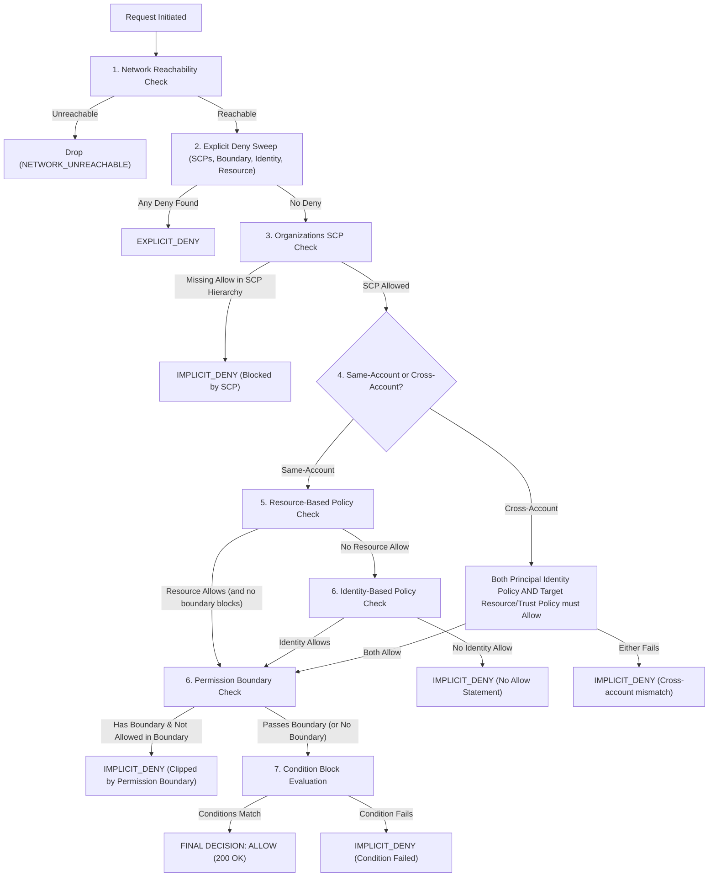

# AWS IAM Simulation Engine Skill

This skill provides the definitive specifications, evaluation algorithms, and reference patterns for the **AccessDenied** deterministic simulation engine.

## 1. The 7-Stage IAM Policy Evaluation Pipeline

Every simulated request tuple `(Principal, Action, Resource, RequestContext)` must be evaluated through the following exact sequential order:

### Critical AWS Edge Cases to Enforce
1. **Explicit Deny Always Wins**: An `Effect: "Deny"` in *any* attached policy statement immediately short-circuits and overrides all `Allow` statements.
2. **KMS Key Policy Delegation Rule**: Unlike S3 where an IAM policy alone grants access within the same account, a KMS Customer Managed Key (CMK) **must** have a Key Policy that explicitly delegates access to the account root (`"Principal": {"AWS": "arn:aws:iam::ACCOUNT_ID:root"}`). If this statement is missing, IAM identity policies cannot grant access to the key.
3. **Cross-Account Access**: When Principal in Account A accesses Resource in Account B, Account A's Identity Policy MUST grant `Allow` AND Account B's Resource Policy (or Role Trust Policy) MUST grant `Allow`.
4. **Permission Boundary**: Can only restrict permissions, never grant them. If a principal has a Permission Boundary attached, both the Identity Policy AND the Permission Boundary must allow the action and resource.

## 2. Supported Condition Operators

| Operator | Evaluated Context Keys | Behavior |
| :--- | :--- | :--- |
| `StringEquals` | `sts:ExternalId`, `aws:PrincipalTag/*`, `s3:prefix` | Exact case-sensitive string match |
| `StringNotEquals` | `aws:PrincipalArn` | Exact inequality |
| `StringEqualsIgnoreCase` | Custom headers, user tags | Case-insensitive match |
| `StringLike` | `s3:prefix`, `aws:RequestTag/*` | Glob matching with `*` and `?` |
| `ArnEquals` | `aws:SourceArn`, `kms:EncryptionContext` | Exact ARN comparison |
| `ArnLike` | `aws:SourceArn` | Wildcard matching on ARN paths |
| `Bool` | `aws:SecureTransport`, `aws:MultiFactorAuthPresent` | Boolean strict check (`"true"` / `"false"` or `boolean`) |
| `IpAddress` | `aws:SourceIp` | IPv4 / CIDR prefix match (e.g. `10.0.0.0/16`) |
| `NotIpAddress` | `aws:SourceIp` | Inverted CIDR check |
| `NumericLessThanEquals` | `ec2:MetadataHttpPutResponseHopLimit` | Hop limit &le; specified integer |
| `NumericEquals` | Port numbers, session duration | Number match |
| `ForAllValues:StringEquals`| `dynamodb:LeadingKeys`, `dynamodb:Attributes` | Every value in request must exist in policy set |
| `ForAnyValue:StringEquals` | DynamoDB or Cognito attributes | At least one value must match |

## 3. Exploit Vectors & Resolution

### Exploit 1: IMDSv1 SSRF Token Exfiltration
- **Vulnerability**: EC2 instance running with `imdsVersion: "v1"` and an over-permissive IAM Role (e.g. `s3:*` on `*`).
- **Attack Payload**: Attacker sends HTTP GET to `http://169.254.169.254/latest/meta-data/iam/security-credentials/`.
- **Target Fix**:
  1. Toggle EC2 to `IMDSv2` (`HttpTokens: "required"`, hop limit: `1`).
  2. Scope EC2 IAM Role identity policy strictly to legitimate bucket prefix (e.g. `arn:aws:s3:::app-invoices/*`).

### Exploit 2: `iam:PassRole` Privilege Escalation
- **Vulnerability**: CI/CD developer role has `iam:PassRole` on `"Resource": "*"` and `lambda:CreateFunction`.
- **Attack Payload**: Attacker creates a Lambda function passing `arn:aws:iam::123456789012:role/OrganizationAdminRole` as the execution role, then invokes it to extract PII data.
- **Target Fix**:
  1. Restrict `iam:PassRole` resource to `arn:aws:iam::123456789012:role/lambda-worker-*`.
  2. Attach a Permission Boundary to prevent developer roles from creating admin-level credentials.

### Exploit 3: Cross-Account Confused Deputy
- **Vulnerability**: Third-party SaaS role has trust policy trusting vendor account (`111122223333`) without requiring an `sts:ExternalId`.
- **Attack Payload**: Malicious tenant of the vendor specifies the victim's Role ARN, and the vendor assumes it.
- **Target Fix**:
  Add `Condition: {"StringEquals": {"sts:ExternalId": "unique-customer-secret-token"}}` in the role's `AssumeRolePolicyDocument`.

## 4. 3-Star Rating Evaluation Formula

1. **Star 1 (Functional)**:
   $$\text{Legitimate Workload Pass Rate} = 100\% \quad (0 \text{ dropped, } 0 \text{ AccessDenied})$$
2. **Star 2 (Secure)**:
   $$\text{Exploits Blocked} = 100\% \quad \text{AND} \quad \text{No Unbounded Admin Roles}$$
3. **Star 3 (Optimal)**:
   $$\text{Monthly Cost} \le \text{Level Target Budget} \quad \text{AND} \quad \text{Least Privilege (No wildcard Action/Resource where specific is required)}$$
