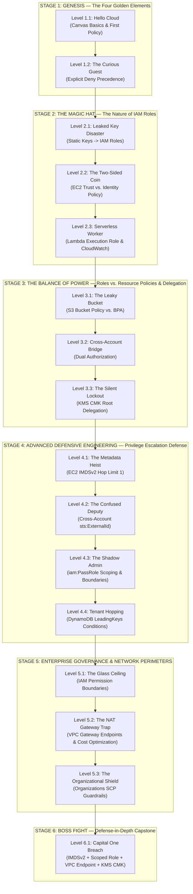

# Learner Experience Roadmap (User Journey) — AccessDenied

> **Design Vision:**   
> Learning AWS IAM is not about memorizing dry JSON syntax. It is about building an intuitive **"Mind Map of Trust Flow"** and ingraining the principle of **Least Privilege**.  
> Learners start from zero (no prior cloud knowledge), progressively explore through interactive simulation (the GonnaCrash-inspired 4-step loop), and finish with a mastery of **IAM Roles**, core cloud services (**EC2, Lambda, S3, DynamoDB, KMS, VPC Networking**), and enterprise defense-in-depth governance.

---

## Part 1: First-Time User Experience (FTUE) Audit

Before designing challenge progression, evaluating the onboarding flow is critical to remove cognitive bottlenecks for beginners.

### 1.1 Existing Strengths
1. **Visual Packet Flow Simulation:**
   - Learners do not have to imagine API mechanics. Green request packets (`200 OK`) and red failure/exploit packets (`403 AccessDenied`) travel live along connection paths on the canvas.
2. **Deterministic Evaluation Trace via IAM Coach:**
   - Rather than displaying a generic error, the IAM Coach breaks down the exact evaluation pipeline step (`Network` → `Explicit Deny` → `SCP` → `KMS Root Delegation` → `Resource Policy` → `Trust Policy` → `Identity Policy` → `Permission Boundary` → `Condition`).
3. **Clear 3-Star Motivation Model:**
   - **⭐ 1 Star (Functional):** Business continuity. 100% of legitimate workload requests return `200 OK`.
   - **⭐⭐ 2 Stars (Secure):** Zero breaches. 100% of adversary exploits are blocked.
   - **⭐⭐⭐ 3 Stars (Optimal):** Financial and architectural discipline. Infrastructure cost stays within the target monthly budget ($/mo), and policies contain zero wildcard permissions.
4. **Offline AI Tutor ("Ask Your Agent"):**
   - Pure, offline prompt generator that exports board topology and Mermaid diagrams so learners can query an AI tutor without leaking the direct solution.

### 1.2 Critical FTUE Bottlenecks for Novices
1. **Cognitive Overload in Round 0 (`round0-cloud-basics`):**
   - *Current State:* Round 0 introduces **8 complex concepts at once**: Principal, Resource, Directed Connection, Identity Policy, Resource Policy, Explicit Deny, Permission Boundary, and Service Control Policy (SCP).
   - *Consequence:* Beginners must simultaneously learn canvas navigation, JSON editing, and advanced enterprise governance controls within 5 minutes.
   - *Fix:* Strip Round 0 down to core basics: canvas navigation, drawing directed connections (`caller → callee`), authoring a single `s3:GetObject` Allow statement, and running the simulation to see green packets.
2. **Missing Eureka Moment for IAM Roles:**
   - *Current State:* Round 0 labels the starter node `PhotoAppRole`, but players edit its identity policy exactly like a normal IAM User.
   - *Consequence:* Learners miss *why* roles exist: *Why not use static access keys? Who assumes the role? What is a Trust Policy?*
3. **JSON Syntax Friction & Schema Compliance:**
   - Beginners frequently struggle with syntax mistakes: missing commas, bracket mismatches, or confusing `"s3:GetObject"` with `["s3:GetObject"]`.
   - All curriculum policy snippets must strictly comply with AWS IAM JSON schema (`"Version": "2012-10-17"`, `"Statement": [...]` array, `"Effect"`, `"Action"`, `"Resource"` / `"Principal"`) per AGENTS.md Rule 4.
4. **Directed Connection Mental Model (`caller → callee`):**
   - Beginners often draw connections backward from S3 to compute ("because S3 returns data to the app").
   - The UI must emphasize that arrows represent API request invocation: **who calls whom**.

---

## Part 2: Exit Competency Framework (Learning Objectives)

Upon completing this journey, learners master five core cloud competencies:

1. **The "Two-Sided Coin" Mental Model of IAM Roles:**
   - **Side 1: Trust Policy (`AssumeRolePolicyDocument`):**
     - Dictates *who is allowed to assume the role* (`Principal: { "Service": "ec2.amazonaws.com" }` vs. `"lambda.amazonaws.com"` vs. external AWS account IDs).
     - Governed by `Action: "sts:AssumeRole"` and optional conditions (e.g., `sts:ExternalId`).
   - **Side 2: Identity Policy:**
     - Dictates *what actions the assumed session can perform* (`Action: "s3:PutObject"`).
   - *Same-Account Role Assumption Rule:* A caller cannot assume a role merely because the trust policy allows it. Same-account `sts:AssumeRole` requires dual authorization: the caller's identity policy must allow `sts:AssumeRole`, AND the role's trust policy must trust the caller principal.
2. **Core Compute Service Execution Profiles:**
   - **Amazon EC2:** Instance Profiles, credential delivery via Instance Metadata Service (IMDS), and securing metadata against SSRF using **IMDSv2** with hop limit 1.
   - **AWS Lambda:** Serverless Execution Roles (`lambda.amazonaws.com`), granting targeted permissions for data stores (S3, DynamoDB) and CloudWatch Logs (`logs:CreateLogStream`, `logs:PutLogEvents`).
   - **Third-Party SaaS Integrations:** Neutralizing the **Confused Deputy** vulnerability using `sts:ExternalId` in cross-account trust policies.
3. **Identity-Based vs. Resource-Based Policies & Delegation:**
   - When to attach policies to callers (roles/users) vs. resources (S3 buckets, KMS keys).
   - **Same-Account vs. Cross-Account Evaluation Rules:**
     - *General S3/DynamoDB Rule:* In same-account access, an Allow in EITHER the Identity Policy OR the Resource Policy is sufficient (provided no explicit Deny). In cross-account access, BOTH the caller's Identity Policy AND the target Resource Policy must allow access.
     - *The KMS CMK Exception:* AWS KMS Customer Managed Keys (CMKs) do NOT follow the standard same-account bypass. An identity policy is completely inert unless the KMS Key Policy explicitly delegates access to the account root (`arn:aws:iam::<account>:root`).
     - *Direct Resource Access vs. Role Assumption:* Distinguish direct cross-account resource access (caller keeps their identity and ARN) from cross-account role assumption (`sts:AssumeRole`, caller switches identity to the target account's role).
4. **VPC Networking & Private Network Perimeters:**
   - Route traffic inside private subnets without public internet exposure.
   - Financial trade-offs: replacing expensive **NAT Gateways** ($32/mo + data fees) with free **VPC Gateway Endpoints** ($0/mo for S3 and DynamoDB).
   - Building data perimeters using Endpoint Policies and S3 Bucket Policies (`aws:sourceVpce`).
5. **Privilege Escalation Defense & Enterprise Governance:**
   - Mitigate `iam:PassRole` privilege escalation risks. Restrict role passing by ARN prefix (`arn:aws:iam::...:role/lambda-worker-*`).
   - Understand why scoping `iam:PassRole` alone is insufficient if developers have `iam:CreateRole`, and how enterprises enforce an `iam:PermissionsBoundary` condition on role creation.
   - **Permission Boundary Mechanics:** Boundaries act as an upper limit ONLY on identity-based policies. They do NOT limit permissions granted by resource-based policies.
   - **Service Control Policies (SCPs):** Organization-wide guardrails that override all member accounts, including the member account root. Understand critical exceptions: the Organizations Management (Payer) Account is exempt; Service-Linked Roles (SLRs) are exempt; SCPs function as a whitelist tree intersection combined with explicit Deny guardrails.

---

## Part 3: Curriculum Roadmap (6 Stages, 15 Levels + 1 Capstone Incident)

The curriculum follows a spiral pedagogy across 6 narrative stages:



---

### STAGE 1: GENESIS — THE FOUR GOLDEN ELEMENTS OF IAM

> **Goal:** Introduce the canvas without cognitive overload. Master the four core questions: *Who? Does what? On which resource? Allow or Deny?*

#### Level 1.1: Hello Cloud (Canvas Basics & Your First Policy)
- **Scenario:** A new employee (`intern-alice`) needs to download quarterly report PDFs from the S3 bucket `company-reports`. Currently, no connection and no policies exist.
- **Unlocked Services:** `iam_user`, `s3`.
- **Core Concepts:**
  - `Principal` (Caller identity: `arn:aws:iam::111122223333:user/intern-alice`).
  - `Resource` (Target resource: `arn:aws:s3:::company-reports/*`).
  - `Action` (`s3:GetObject`).
  - `Effect: "Allow"`.
  - Directed connection (`caller → callee`).
- **Player Actions:**
  1. Draw a connection line from `intern-alice` to `company-reports` (reinforcing `caller → callee`).
  2. Open the **Identity Policy** tab of `intern-alice` and enter a compliant policy:
     ```json
     {
       "Version": "2012-10-17",
       "Statement": [
         {
           "Sid": "AllowReportRead",
           "Effect": "Allow",
           "Action": "s3:GetObject",
           "Resource": "arn:aws:s3:::company-reports/*"
         }
       ]
     }
     ```
  3. Click **Simulate** and watch the green packet flow (`200 OK`).
- **3-Star Criteria:**
  - ⭐ **Functional:** Legitimate report read requests return `200 OK`.
  - ⭐⭐ **Secure:** 100% exploits blocked; no wildcard Action (`s3:GetObject`, not `*` or `s3:*`).
  - ⭐⭐⭐ **Optimal:** Monthly budget <= $10/mo (target budget $10/mo; IAM User $0/mo + S3 Bucket $5/mo = $5/mo <= $10/mo); exact resource ARN `arn:aws:s3:::company-reports/*`.

#### Level 1.2: The Curious Guest (Explicit Deny Always Wins)
- **Scenario:** `intern-alice` has broad read permissions on `company-reports/*`. However, the bucket contains a confidential directory `/salaries/*`. A curious request attempts to read executive payroll files.
- **Core Concepts:**
  - `Explicit Deny` overrides `Allow`.
  - Resource ARN prefix partitioning.
- **Player Actions:**
  1. Observe that salary read requests currently succeed because the previous statement allows reading the entire bucket.
  2. Add a second statement with `Effect: "Deny"` on `Resource: "arn:aws:s3:::company-reports/salaries/*"`:
     ```json
     {
       "Version": "2012-10-17",
       "Statement": [
         {
           "Sid": "AllowGeneralReports",
           "Effect": "Allow",
           "Action": "s3:GetObject",
           "Resource": "arn:aws:s3:::company-reports/*"
         },
         {
           "Sid": "DenySalaryFolder",
           "Effect": "Deny",
           "Action": "s3:GetObject",
           "Resource": "arn:aws:s3:::company-reports/salaries/*"
         }
       ]
     }
     ```
  3. Run simulation: Report requests succeed (`200 OK`), while salary requests fail (`403 AccessDenied`).
- **Key Takeaway:** "If any policy statement matches with Deny, it beats every Allow anywhere in the request."
- **3-Star Criteria:**
  - ⭐ **Functional:** 100% legitimate report requests return `200 OK`.
  - ⭐⭐ **Secure:** 100% unauthorized salary requests blocked by Explicit Deny.
  - ⭐⭐⭐ **Optimal:** Monthly budget <= $10/mo (target budget $10/mo; IAM User $0/mo + S3 Bucket $5/mo = $5/mo <= $10/mo); scoped prefix path for Deny statement.

---

### STAGE 2: THE MAGIC HAT — THE NATURE OF IAM ROLES

> **Goal:** Eliminate hardcoded access keys on servers. Understand how IAM Roles provide short-lived credentials for **EC2** and **Lambda**.

#### Level 2.1: The Leaked Key Disaster (Why IAM Roles Exist)
- **Scenario:** A production EC2 web server runs an e-commerce application. A developer previously hardcoded an IAM User's access keys directly into the app repository. The repository was accidentally made public on GitHub! Automated scraper bots immediately use the keys to exfiltrate database backups.
- **Unlocked Services:** `ec2`, `iam_role`.
- **Core Concepts:**
  - Fatal risk of long-term credentials (static access keys).
  - Concept of **IAM Role**: A temporary credential issuer with no permanent passwords or secrets.
  - **EC2 Instance Profile**: The vehicle that delivers temporary IAM Role credentials to an EC2 instance.
- **Player Actions:**
  1. Revoke and delete the compromised IAM User credentials attached to EC2.
  2. Create an IAM Role node (`WebServerRole`) and attach it to the EC2 instance via its Instance Profile.
  3. Attach an identity policy granting `s3:GetObject` on product catalog assets:
     ```json
     {
       "Version": "2012-10-17",
       "Statement": [
         {
           "Sid": "AllowProductCatalogRead",
           "Effect": "Allow",
           "Action": "s3:GetObject",
           "Resource": "arn:aws:s3:::product-catalog-assets/*"
         }
       ]
     }
     ```
  4. Run simulation: Adversary requests using the old static access key are blocked (`403 AccessDenied`); EC2 accesses product images using auto-rotated temporary credentials.
- **3-Star Criteria:**
  - ⭐ **Functional:** 100% legitimate web server requests return `200 OK`.
  - ⭐⭐ **Secure:** 100% leaked key requests blocked; static credentials eliminated.
  - ⭐⭐⭐ **Optimal:** Monthly budget <= $20/mo (target budget $20/mo; EC2 $15/mo + S3 $5/mo + IAM Role $0/mo = $20/mo); instance profile attached.

#### Level 2.2: The Two-Sided Coin (Trust Policy vs. Identity Policy on EC2)
- **Scenario:** You created `AppWorkerRole` with an identity policy allowing `s3:PutObject`. However, when the EC2 instance boots up and attempts to upload files to S3, every request fails with `403 AccessDenied`.
- **Core Concepts:**
  - **Trust Policy (`AssumeRolePolicyDocument`):** Defines *who is authorized to assume this role*.
  - Principal: `{ "Service": "ec2.amazonaws.com" }`.
  - Separation of concerns: Trust Policy opens the door for EC2 to assume the role; Identity Policy determines what actions the role can perform once assumed.
- **Player Actions:**
  1. Inspect the **Trust Policy** tab of `AppWorkerRole` and discover it is empty or specifies the wrong principal.
  2. Configure a valid Trust Policy:
     ```json
     {
       "Version": "2012-10-17",
       "Statement": [
         {
           "Sid": "AllowEC2AssumeRole",
           "Effect": "Allow",
           "Principal": {
             "Service": "ec2.amazonaws.com"
           },
           "Action": "sts:AssumeRole"
         }
       ]
     }
     ```
  3. Verify the **Identity Policy** tab contains `s3:PutObject` on the target bucket.
  4. Run simulation: EC2 successfully assumes the role and uploads data to S3.
- **3-Star Criteria:**
  - ⭐ **Functional:** 100% worker uploads succeed (`200 OK`).
  - ⭐⭐ **Secure:** Trust Policy restricted strictly to `ec2.amazonaws.com` (no wildcard principal).
  - ⭐⭐⭐ **Optimal:** Monthly budget <= $20/mo (target budget $20/mo; EC2 $15/mo + S3 $5/mo + IAM Role $0/mo = $20/mo); exact S3 object prefix permissions.

#### Level 2.3: Serverless Worker (Lambda Execution Role)
- **Scenario:** An automated order processing function (`OrderProcessor`) in AWS Lambda must read incoming orders, update order status in `OrdersTable` (DynamoDB), and write runtime error logs to **CloudWatch Logs** for operational debugging.
- **Unlocked Services:** `lambda`, `dynamodb`.
- **Core Concepts:**
  - **Lambda Execution Role:** `Principal: { "Service": "lambda.amazonaws.com" }`.
  - Baseline serverless permissions: Business operations (`dynamodb:UpdateItem`) + Observability operations (`logs:CreateLogStream`, `logs:PutLogEvents`).
- **Player Actions:**
  1. Configure the Trust Policy for `lambda.amazonaws.com`:
     ```json
     {
       "Version": "2012-10-17",
       "Statement": [
         {
           "Sid": "AllowLambdaAssumeRole",
           "Effect": "Allow",
           "Principal": {
             "Service": "lambda.amazonaws.com"
           },
           "Action": "sts:AssumeRole"
         }
       ]
     }
     ```
  2. Configure the Identity Policy granting scoped DynamoDB update actions and CloudWatch logging:
     ```json
     {
       "Version": "2012-10-17",
       "Statement": [
         {
           "Sid": "OrderTableUpdate",
           "Effect": "Allow",
           "Action": [
             "dynamodb:GetItem",
             "dynamodb:UpdateItem"
           ],
           "Resource": "arn:aws:dynamodb:us-east-1:111122223333:table/OrdersTable"
         },
         {
           "Sid": "CloudWatchLogging",
           "Effect": "Allow",
           "Action": [
             "logs:CreateLogStream",
             "logs:PutLogEvents"
           ],
           "Resource": "arn:aws:logs:us-east-1:111122223333:log-group:/aws/lambda/OrderProcessor:*"
         }
       ]
     }
     ```
  3. Run simulation: Orders process cleanly and audit logs record without error.
- **Key Takeaway:** "Every serverless function is a principal and requires an Execution Role with permissions for both business logic and system logging."
- **3-Star Criteria:**
  - ⭐ **Functional:** 100% order processing operations succeed (`200 OK`).
  - ⭐⭐ **Secure:** Zero wildcard administrative permissions (`dynamodb:*` blocked).
  - ⭐⭐⭐ **Optimal:** Monthly budget <= $15/mo (target budget $15/mo; Lambda $5/mo + DynamoDB $10/mo = $15/mo); least-privilege action scoping.

---

### STAGE 3: THE BALANCE OF POWER — ROLES VS. RESOURCE-BASED POLICIES & DELEGATION

> **Goal:** Distinguish permission enforcement on the Caller (IAM Role) vs. on the Destination (Bucket / KMS Key), especially during cross-account access and cryptographic delegation.

#### Level 3.1: The Leaky Bucket (S3 Bucket Policies vs. Block Public Access)
- **Scenario:** The bucket `customer-invoices` stores sensitive billing PDFs. To facilitate quick developer testing, an engineer wrote a Bucket Policy with `"Principal": "*"` and disabled S3 Block Public Access. Internet web crawlers are actively harvesting customer receipts!
- **Core Concepts:**
  - **Resource-based Policy (S3 Bucket Policy):** Access rules attached directly to the resource itself.
  - **S3 Block Public Access (BPA):** Account-level and bucket-level guardrails that override permissive bucket policies to block public access.
- **Player Actions:**
  1. Turn on the **Block Public Access** switch on the S3 bucket.
  2. Edit the S3 Bucket Policy: Replace `"Principal": "*"` with the specific ARN of `BillingAppRole`:
     ```json
     {
       "Version": "2012-10-17",
       "Statement": [
         {
           "Sid": "AllowBillingAppOnly",
           "Effect": "Allow",
           "Principal": {
             "AWS": "arn:aws:iam::111122223333:role/BillingAppRole"
           },
           "Action": [
             "s3:GetObject",
             "s3:PutObject"
           ],
           "Resource": "arn:aws:s3:::customer-invoices/*"
         }
       ]
     }
     ```
  3. Run simulation: Legitimate billing app reads and writes invoices (`200 OK`); internet scrapers receive `403 AccessDenied`.
- **3-Star Criteria:**
  - ⭐ **Functional:** 100% billing app operations return `200 OK`.
  - ⭐⭐ **Secure:** 100% public scraper probes blocked; BPA enabled.
  - ⭐⭐⭐ **Optimal:** Monthly budget <= $25/mo (target budget $25/mo; Billing Web Server EC2 $15/mo + S3 Bucket $5/mo = $20/mo <= $25/mo); scoped bucket policy.

#### Level 3.2: The Cross-Account Bridge (Cross-Account Dual Authorization)
- **Scenario:** Your company operates two AWS accounts: **Account A** (Application Environment running EC2) and **Account B** (Central Data Lake). The EC2 application in Account A needs to read analytics files from an S3 bucket in Account B.
- **Core Concepts:**
  - **The Dual Authorization Rule:**
    - *Same-Account:* An Allow in EITHER the Identity Policy OR the Resource Policy is sufficient for standard data access (e.g., S3 or DynamoDB). *Crucial Exceptions:* This bypass does NOT apply to AWS KMS CMK keys (which strictly require Key Policy root delegation before identity policies can take effect, as taught in Level 3.3) or same-account `sts:AssumeRole` (which strictly requires dual authorization: the caller's identity policy must allow `sts:AssumeRole` AND the target role's trust policy must trust the caller).
    - *Cross-Account:* BOTH sides must explicitly grant Allow: the Identity Policy in Account A **AND** the Resource Policy in Account B!
  - *Distinction:* Direct cross-account resource access (caller keeps its Account A identity and accesses the bucket directly) vs. cross-account role assumption (`sts:AssumeRole`, caller assumes a role in Account B and adopts Account B's identity).
  - *Enterprise Scalability:* While hardcoding Account A's role ARN teaches the baseline dual-authorization rule, real-world multi-account data perimeters scale using the `aws:PrincipalOrgID` or `aws:ResourceOrgID` condition key, allowing any authorized account in the AWS Organization to access the bucket without updating bucket policies on every new account addition.
- **Player Actions:**
  1. Add `s3:GetObject` to `AppRole`'s Identity Policy in Account A.
  2. Open the S3 Bucket Policy in Account B and add a statement granting access to `AppRole`:
     ```json
     {
       "Version": "2012-10-17",
       "Statement": [
         {
           "Sid": "AllowCrossAccountAnalytics",
           "Effect": "Allow",
           "Principal": {
             "AWS": "arn:aws:iam::111122223333:role/AppRole"
           },
           "Action": "s3:GetObject",
           "Resource": "arn:aws:s3:::analytics-data-lake/*"
         }
       ]
     }
     ```
  3. Run simulation: If either side is missing, the packet drops; data flows only when both sides grant permission.
- **3-Star Criteria:**
  - ⭐ **Functional:** 100% cross-account analytics queries succeed (`200 OK`).
  - ⭐⭐ **Secure:** 100% unauthorized external accounts blocked.
  - ⭐⭐⭐ **Optimal:** Monthly budget <= $25/mo (target budget $25/mo; Account A EC2 $15/mo + Account B S3 $5/mo = $20/mo <= $25/mo); exact ARNs on both sides.

#### Level 3.3: The Silent Lockout (KMS CMK Key Policies & Root Delegation)
- **Scenario:** A backend service encrypts sensitive payment tokens using a custom KMS Customer Managed Key (CMK). The developer granted `"kms:Decrypt"` in the Payment Processor Lambda role, but every request fails with a mysterious `403 AccessDenied` error!
- **Unlocked Services:** `kms` (Key Management Service).
- **Core Concepts:**
  - **The Critical KMS Exception to Same-Account Bypass:**
    - In standard S3 access within the same account, an identity policy Allow is sufficient even without an explicit bucket policy.
    - **AWS KMS CMKs do NOT allow this bypass!** In KMS, Key Policies are primary. An IAM identity policy alone has ZERO power unless the KMS Key Policy explicitly delegates administration/access to the account root (`"arn:aws:iam::111122223333:root"`).
    - Without root delegation, IAM policies cannot grant key usage, causing an unexplained "Silent Lockout."
- **Player Actions:**
  1. Inspect the Key Policy on the KMS CMK node.
  2. Add the mandatory account root delegation statement:
     ```json
     {
       "Version": "2012-10-17",
       "Statement": [
         {
           "Sid": "EnableRootDelegation",
           "Effect": "Allow",
           "Principal": {
             "AWS": "arn:aws:iam::111122223333:root"
           },
           "Action": "kms:*",
           "Resource": "*"
         }
       ]
     }
     ```
  3. Verify the Payment Processor Lambda has an identity policy with scoped `kms:Decrypt` on the CMK ARN.
  4. Run simulation: Payment Lambda successfully decrypts payment tokens (`200 OK`); rogue workers without `kms:Decrypt` are blocked.
- **Key Takeaway:** "KMS is unique: an identity policy cannot grant access to a Customer Managed Key unless the Key Policy first delegates control to the account root."
- **3-Star Criteria:**
  - ⭐ **Functional:** 100% payment token decryptions succeed (`200 OK`).
  - ⭐⭐ **Secure:** Rogue workers without `kms:Decrypt` blocked.
  - ⭐⭐⭐ **Optimal:** Monthly budget <= $15/mo (target budget $15/mo; Lambda $5/mo + KMS CMK $1/mo + payment storage $4/mo = $10/mo <= $15/mo); root delegation configured with scoped actions.

---

### STAGE 4: ADVANCED DEFENSIVE ENGINEERING — PREVENTING PRIVILEGE ESCALATION

> **Goal:** Defend against real-world cloud attack vectors targeting IAM Roles: SSRF metadata theft, Confused Deputy vulnerabilities, `iam:PassRole` privilege escalation, and multi-tenant table bleeding.

#### Level 4.1: The Metadata Heist (EC2 IMDSv2 & Token Protection)
- **Scenario:** A website URL previewer service on EC2 suffers from a Server-Side Request Forgery (SSRF) flaw. An attacker coerces the server into making an HTTP request to `http://169.254.169.254/latest/meta-data/iam/security-credentials/` to steal the instance profile's temporary credentials and exfiltrate private S3 data!
- **Core Concepts:**
  - **IMDSv1 vs. IMDSv2:** IMDSv1 uses simple HTTP GET requests that are easily exploited via SSRF; IMDSv2 requires a session token obtained via HTTP PUT with a custom header.
  - **Hop Limit:** Enforcing `ec2:MetadataHttpPutResponseHopLimit = 1` prevents session tokens from traversing container bridges or reverse proxies.
  - Scoping down the EC2 role's S3 permissions to the minimum necessary bucket prefix.
- **Player Actions:**
  1. Enforce **Require IMDSv2** on the EC2 instance node.
  2. Set `Hop Limit = 1`.
  3. Scope down the EC2 instance's IAM role: replace over-permissive wildcard S3 access with a least-privilege policy allowing thumbnail read/write operations on the application storage bucket (`arn:aws:s3:::app-storage/*`):
     ```json
     {
       "Version": "2012-10-17",
       "Statement": [
         {
           "Sid": "ScopedThumbnailStorage",
           "Effect": "Allow",
           "Action": [
             "s3:GetObject",
             "s3:PutObject"
           ],
           "Resource": "arn:aws:s3:::app-storage/*"
         }
       ]
     }
     ```
  4. Run simulation: Attacker SSRF probe is blocked by IMDSv2; preview worker continues serving legitimate traffic.
- **3-Star Criteria:**
  - ⭐ **Functional:** 100% URL preview workloads succeed (`200 OK`).
  - ⭐⭐ **Secure:** 100% SSRF metadata extraction attempts blocked.
  - ⭐⭐⭐ **Optimal:** Monthly budget <= $25/mo (target budget $25/mo; EC2 $15/mo base + two storage buckets $10/mo = $25/mo); IMDSv2 enforced with hop limit 1 and scoped S3 prefix on app-storage/*.

#### Level 4.2: The Confused Deputy (Cross-Account Delegation & `sts:ExternalId`)
- **Scenario:** You integrate with a third-party analytics SaaS vendor (`AnalyticsVendor`). You create `VendorRole` allowing the vendor's AWS account to assume the role. A competitor also uses the vendor SaaS, discovers your Role ARN, and configures their SaaS workspace to query your data lake using the vendor's shared credentials!
- **Core Concepts:**
  - **The Confused Deputy Problem:** A trusted intermediary is tricked by a malicious caller into abusing its permissions against an unwitting victim.
  - **Cryptographic Shared Secret:** Enforcing `sts:ExternalId` in the role's Trust Policy.
  - **Third-Party SaaS vs. AWS Cross-Service Confused Deputy:**
    - *Third-Party SaaS:* Solved by requiring `sts:ExternalId` in the role's Trust Policy.
    - *AWS-Native Cross-Service:* When an AWS service (such as SNS, S3, or CloudWatch) invokes actions across accounts on your behalf, AWS defends against confused deputy attacks using the `aws:SourceArn` and `aws:SourceAccount` condition keys in resource policies or service roles.
- **Player Actions:**
  1. Open the Trust Policy of `VendorRole`.
  2. Add a `Condition` block requiring a unique `sts:ExternalId`:
     ```json
     {
       "Version": "2012-10-17",
       "Statement": [
         {
           "Sid": "AllowVendorWithExternalId",
           "Effect": "Allow",
           "Principal": {
             "AWS": "arn:aws:iam::999988887777:root"
           },
           "Action": "sts:AssumeRole",
           "Condition": {
             "StringEquals": {
               "sts:ExternalId": "company-secret-passphrase-9981"
             }
           }
         }
       ]
     }
     ```
  3. Run simulation: Legitimate vendor requests supplying the correct ExternalId succeed (`200 OK`); rival customer assume-role requests are rejected (`403 AccessDenied`).
- **3-Star Criteria:**
  - ⭐ **Functional:** 100% authorized vendor analytics jobs succeed (`200 OK`).
  - ⭐⭐ **Secure:** 100% confused deputy assume-role attempts blocked.
  - ⭐⭐⭐ **Optimal:** Monthly budget <= $20/mo (target budget $20/mo; S3 storage $5/mo + vendor identities $0/mo = $5/mo <= $20/mo); cryptographic ExternalId condition enforced.

#### Level 4.3: The Shadow Admin (`iam:PassRole` & Privilege Escalation Defense)
- **Scenario:** A CI/CD deployment pipeline bot deploys serverless functions for development teams. A developer granted the bot `iam:PassRole` with `Resource: "*"`. An attacker compromises the CI/CD bot and attempts to deploy a rogue Lambda attached to `OrganizationAdminRole` to achieve full administrative control over the entire cloud!
- **Core Concepts:**
  - High risk of `iam:PassRole`: allows a principal to delegate a role to a compute service (Lambda/EC2).
  - **Privilege Escalation:** Using a lower-privilege identity to activate a superuser role.
  - Scoping `iam:PassRole` resource ARNs to `arn:aws:iam::111122223333:role/lambda-worker-*`.
  - Enterprise linkage: Scoping PassRole ARNs alone does not prevent escalation if the developer can create new roles. Complete defense requires enforcing an `iam:PermissionsBoundary` condition on `iam:CreateRole`.
- **Player Actions:**
  1. Inspect the CI/CD bot's Identity Policy.
  2. Restrict the `Resource` in `iam:PassRole` strictly to worker execution roles:
     ```json
     {
       "Version": "2012-10-17",
       "Statement": [
         {
           "Sid": "ScopedPassRole",
           "Effect": "Allow",
           "Action": "iam:PassRole",
           "Resource": "arn:aws:iam::111122223333:role/lambda-worker-*"
         }
       ]
     }
     ```
  3. Run simulation: CI/CD bot deploys worker functions normally; attempts to pass `OrganizationAdminRole` are blocked.
- **3-Star Criteria:**
  - ⭐ **Functional:** 100% CI/CD worker deployments succeed (`200 OK`).
  - ⭐⭐ **Secure:** 100% admin privilege escalation attempts blocked.
  - ⭐⭐⭐ **Optimal:** Monthly budget <= $20/mo (target budget $20/mo; Lambda execution worker $5/mo + IAM identities $0/mo = $5/mo <= $20/mo); scoped role ARN prefix.

#### Level 4.4: Tenant Hopping (DynamoDB Fine-Grained Conditions)
- **Scenario:** A multi-tenant SaaS application shares a single DynamoDB table (`TenantDataTable`). A flawed application role allows `dynamodb:GetItem` across all partition keys. Tenant A crafts a request attempting to read records belonging to Tenant B (`TENANT#bravo`).
- **Core Concepts:**
  - Fine-grained access control using IAM Condition Keys.
  - `dynamodb:LeadingKeys`: Restricts the partition key to the caller's authorized tenant identifier.
  - Defense against the "vacuous truth" pitfall: ensuring query actions cannot bypass partition checks.
  - **Session Tagging Prerequisite:** Dynamic policy variables like `${aws:PrincipalTag/TenantId}` require caller session tags (passed via Cognito Identity Pools or `sts:TagSession`). The current engine evaluates literal string keys `["TENANT#alpha"]` per `round5-tenant-hopping.ts`, with dynamic variable interpolation tracked in Part 5.
- **Player Actions:**
  1. Add a `dynamodb:LeadingKeys` condition to the application role's Identity Policy:
     ```json
     {
       "Version": "2012-10-17",
       "Statement": [
         {
           "Sid": "TenantIsolatedDynamoAccess",
           "Effect": "Allow",
           "Action": [
             "dynamodb:GetItem",
             "dynamodb:Query"
           ],
           "Resource": "arn:aws:dynamodb:us-east-1:111122223333:table/TenantDataTable",
           "Condition": {
             "ForAllValues:StringEquals": {
               "dynamodb:LeadingKeys": ["TENANT#alpha"]
             }
           }
         }
       ]
     }
     ```
  2. Run simulation: Tenant Alpha reads their own data (`200 OK`); cross-tenant read attempts receive `403 AccessDenied`.
- **3-Star Criteria:**
  - ⭐ **Functional:** 100% tenant workloads read own records (`200 OK`).
  - ⭐⭐ **Secure:** 100% cross-tenant data hopping attempts blocked.
  - ⭐⭐⭐ **Optimal:** Monthly budget <= $20/mo (target budget $20/mo; DynamoDB table $10/mo + compute worker $5/mo = $15/mo <= $20/mo); strict partition key scoping.

---

### STAGE 5: ENTERPRISE GOVERNANCE & NETWORK PERIMETERS

> **Goal:** Master enterprise guardrails, private network egress routing, and organizational governance structures.

#### Level 5.1: The Glass Ceiling (IAM Permission Boundaries)
- **Scenario:** You want to empower developers to create IAM roles and Lambda functions for experiments without waiting days for security tickets. But how do you prevent developers from granting themselves `AdministratorAccess`?
- **Core Concepts:**
  - **Permission Boundary Mechanics:** An advanced guardrail that acts as an upper ceiling ONLY on **identity-based policies** attached to that IAM user or role.
  - **Critical Evaluation Rule:** Permission Boundaries do **NOT** evaluate, clip, or restrict permissions granted by **Resource-based policies** (such as an S3 Bucket Policy).
  - **Enforcing Developer Delegation:** Developers can create roles only if they attach a mandatory Permission Boundary (`iam:PermissionsBoundary` condition on `iam:CreateRole`).
- **Player Actions:**
  1. Author the **Permission Boundary Policy** (`DeveloperBoundary`) granting baseline data and logging permissions:
     ```json
     {
       "Version": "2012-10-17",
       "Statement": [
         {
           "Sid": "DeveloperPermissionBoundary",
           "Effect": "Allow",
           "Action": [
             "s3:GetObject",
             "s3:PutObject",
             "dynamodb:GetItem",
             "dynamodb:PutItem",
             "logs:CreateLogStream",
             "logs:PutLogEvents"
           ],
           "Resource": "*"
         }
       ]
     }
     ```
  2. Attach an IAM delegation policy ensuring the developer can only create roles if the boundary is attached:
     ```json
     {
       "Version": "2012-10-17",
       "Statement": [
         {
           "Sid": "AllowCreateRoleWithBoundaryOnly",
           "Effect": "Allow",
           "Action": [
             "iam:CreateRole",
             "iam:AttachRolePolicy"
           ],
           "Resource": "arn:aws:iam::111122223333:role/dev-*",
           "Condition": {
             "StringEquals": {
               "iam:PermissionsBoundary": "arn:aws:iam::111122223333:policy/DeveloperBoundary"
             }
           }
         }
       ]
     }
     ```
  3. Run simulation: Developer can grant S3 and DynamoDB permissions; attempts to grant `iam:*` or `kms:*` are clipped by the boundary.
- **3-Star Criteria:**
  - ⭐ **Functional:** 100% dev workload tests pass (`200 OK`).
  - ⭐⭐ **Secure:** 100% unauthorized privilege expansion attempts clipped by boundary.
  - ⭐⭐⭐ **Optimal:** Monthly budget <= $20/mo (target budget $20/mo; developer test workloads $10/mo + IAM identities $0/mo = $10/mo <= $20/mo); least-privilege boundary specification.

#### Level 5.2: The NAT Gateway Trap (VPC Endpoints & Cost Optimization)
- **Scenario:** A high-throughput Lambda function in a Private Subnet ingests and analyzes server logs stored in S3. The architecture connects through a NAT Gateway costing $32/mo base plus massive data transfer fees, blowing through the startup's monthly budget cap ($15/mo)!
- **Unlocked Services:** `nat_gw`, `vpc_endpoint`.
- **Core Concepts:**
  - **Private Subnet Routing:** Private compute nodes cannot reach public AWS service APIs directly without an egress route.
  - **Financial & Architectural Trade-off:** An expensive **NAT Gateway** ($32/mo) vs. a completely free **VPC Gateway Endpoint for S3** ($0/mo).
  - Resolving the Stage 6 cognitive cliff: Mastering VPC Endpoints and Private Routes *before* the Boss Fight!
  - **Data Perimeter:** Endpoint Policies restrict reachable S3 resources within the private network.
- **Player Actions:**
  1. Analyze architecture cost: Observe that the NAT Gateway costs $32/mo, exceeding the $15/mo budget cap.
  2. Delete the expensive NAT Gateway node.
  3. Drag an S3 VPC Gateway Endpoint ($0/mo) onto the canvas.
  4. Wire private routing: `Log Ingest Worker` → `S3 Gateway Endpoint` → `application-logs` S3 bucket.
  5. Attach a least-privilege endpoint policy:
     ```json
     {
       "Version": "2012-10-17",
       "Statement": [
         {
           "Sid": "AllowAppLogsViaEndpoint",
           "Effect": "Allow",
           "Principal": "*",
           "Action": [
             "s3:GetObject",
             "s3:PutObject"
           ],
           "Resource": "arn:aws:s3:::application-logs/*"
         }
       ]
     }
     ```
  6. Run simulation: Log processing succeeds (`200 OK`); infrastructure cost drops to $10/mo (within $15/mo budget); traffic stays on the AWS private backbone.
- **3-Star Criteria:**
  - ⭐ **Functional:** 100% private subnet log read/write operations succeed (`200 OK`).
  - ⭐⭐ **Secure:** 100% traffic routed privately through VPC Endpoint without internet exposure.
  - ⭐⭐⭐ **Optimal:** Monthly budget <= $15/mo (target budget $15/mo; Lambda $5/mo + S3 $5/mo + VPC Gateway Endpoint $0/mo = $10/mo <= $15/mo, eliminating $32/mo NAT Gateway).

#### Level 5.3: The Organizational Shield (Organizations SCP Guardrails)
- **Scenario:** In a multi-account enterprise, a member account's root credentials are leaked. An attacker attempts to disable CloudTrail, delete S3 bucket policies, and spin up expensive GPU instances in unauthorized regions (`ap-east-1`).
- **Core Concepts:**
  - **Service Control Policies (SCPs):** Central guardrails managed at the AWS Organizations or OU level. SCPs specify the maximum available permissions (guardrails) for member accounts and never grant permissions on their own—an identity or resource policy must still grant access.
  - SCP Explicit Deny overrides all member account policies, including actions taken by the member account root!
  - **Critical Exemptions & Mechanics:**
    1. The Organizations Management (Payer) Account is exempt from SCPs.
    2. Service-Linked Roles (SLRs) are exempt from SCPs.
    3. SCPs operate as a whitelist tree intersection from Root down to Account (`FullAWSAccess`) combined with explicit Denies.
- **Player Actions:**
  1. Attach an OU-level SCP with explicit Deny for security-critical actions and unauthorized regions:
     ```json
     {
       "Version": "2012-10-17",
       "Statement": [
         {
           "Sid": "DenyDisablingCloudTrail",
           "Effect": "Deny",
           "Action": [
             "cloudtrail:StopLogging",
             "cloudtrail:DeleteTrail"
           ],
           "Resource": "*"
         },
         {
           "Sid": "DenyUnapprovedRegionsExceptDR",
           "Effect": "Deny",
           "Action": "*",
           "Resource": "*",
           "Condition": {
             "StringNotEquals": {
               "aws:RequestedRegion": [
                 "us-east-1"
               ],
               "aws:PrincipalArn": [
                 "arn:aws:iam::111122223333:role/DRBackupRole"
               ]
             }
           }
         }
       ]
     }
     ```
  2. Run simulation: Attacker root session is blocked from stopping logging or launching unauthorized instances; production backups proceed.
- **3-Star Criteria:**
  - ⭐ **Functional:** 100% legitimate production workloads succeed (`200 OK`).
  - ⭐⭐ **Secure:** 100% tampering attempts blocked at Organization level.
  - ⭐⭐⭐ **Optimal:** Monthly budget <= $45/mo (target budget $45/mo; DR backup worker $15/mo + cross-region S3 backup vault $10/mo = $25/mo <= $45/mo); scoped SCP condition with DR backup exemptions.

---

### STAGE 6: BOSS FIGHT — DECONSTRUCTING THE CAPITAL ONE BREACH

#### Level 6.1: The Capital One Historic Cloud Breach (Incident 2019 Capstone)
- **Real-World Incident:** The 2019 breach compromising over 100 million credit card customer records.
- **The Multi-Hop Attack Chain:**
  1. Attacker scans and discovers an SSRF vulnerability on an EC2-hosted Web Application Firewall (WAF).
  2. Attacker calls IMDSv1 to extract temporary security credentials from the WAF Instance Profile.
  3. Configuration flaw: The WAF Role was granted broad `AmazonS3FullAccess` (`*` on `*`).
  4. Attacker uses stolen credentials with `s3:Sync` to exfiltrate customer credit card records.
- **Why Stage 6 is a True Defense-in-Depth Capstone (Differentiated from Level 4.1):**
  - Level 4.1 focused purely on isolated IMDSv2 configuration and basic bucket prefixing.
  - Stage 6 is a multi-layered enterprise defense-in-depth challenge integrating **Compute, Identity, Network Perimeters, and Cryptographic Controls**:
    1. **Compute Layer:** Enforce IMDSv2 with `Hop Limit = 1` on the WAF EC2 node.
    2. **Identity Layer:** Strip wildcard S3 permissions from the WAF Role; grant only minimal logging and WAF metrics actions.
    3. **Network Perimeter Layer:** Leverage skills from Level 5.2 to isolate the customer credit card bucket behind a VPC S3 Gateway Endpoint and restrict the bucket policy using `aws:sourceVpce`.
    4. **Data Encryption Layer:** Leverage skills from Level 3.3 to encrypt customer records using a KMS Customer Managed Key with strict root delegation and service-scoped decryption.
- **Player Actions & Remediation:**
  1. Enforce IMDSv2 with `Hop Limit = 1` on WAF EC2.
  2. Scope down WAF Role policy to least privilege (WAF logging only):
     ```json
     {
       "Version": "2012-10-17",
       "Statement": [
         {
           "Sid": "StrictWafLogging",
           "Effect": "Allow",
           "Action": "s3:PutObject",
           "Resource": "arn:aws:s3:::security-waf-logs/*"
         }
       ]
     }
     ```
  3. Attach an S3 Gateway Endpoint and configure the S3 Bucket Policy with an `aws:sourceVpce` condition:
     ```json
     {
       "Version": "2012-10-17",
       "Statement": [
         {
           "Sid": "RestrictToVpcEndpointOnly",
           "Effect": "Deny",
           "Principal": "*",
           "Action": "s3:*",
           "Resource": [
             "arn:aws:s3:::customer-credit-records",
             "arn:aws:s3:::customer-credit-records/*"
           ],
           "Condition": {
             "StringNotEquals": {
               "aws:sourceVpce": "vpce-0123456789abcdef0"
             }
           }
         }
       ]
     }
     ```
  4. Ensure customer PII is encrypted with a custom KMS key that requires root delegation and limits `kms:Decrypt` strictly to authorized payment processors.
  5. Run simulation: Legitimate credit application processing and WAF logging return `200 OK`; SSRF probes, stolen token replays, and unauthorized decrypt attempts are blocked.
- **Victory Screen:** Unlocks the **"Master of Cloud IAM"** credential!
- **3-Star Criteria:**
  - ⭐ **Functional:** 100% legitimate credit application processing and WAF logging return `200 OK`.
  - ⭐⭐ **Secure:** 100% SSRF probes, stolen token replays, and unauthorized decrypt attempts blocked.
  - ⭐⭐⭐ **Optimal:** Monthly budget <= $35/mo (target budget $35/mo; WAF EC2 $15/mo, S3 Bucket $5/mo, VPC Gateway Endpoint $0/mo, KMS CMK $1/mo, DB/Worker $14/mo = $35/mo); zero wildcard permissions.

---

## Part 4: Master Knowledge Matrix

This matrix maps AWS services, policy types, core concepts, and challenge levels across the entire curriculum:

| AWS Service / Domain | Primary Policy Types | Core Concepts & Evaluation Mechanics | Level Applications |
| :--- | :--- | :--- | :--- |
| **IAM Core** | Identity Policy & Credentials | Effect (Allow/Deny), Action, Resource ARN, Explicit Deny Precedence, Static Key Revocation | Level 1.1, 1.2, 2.1, 2.2, 4.3, 5.1 |
| **Amazon EC2** | Trust Policy + Instance Profile | `ec2.amazonaws.com`, IMDSv1 vs IMDSv2, Hop Limit 1, SSRF Token Defense | Level 2.1, 2.2, 3.1, 3.2, 4.1, Stage 6 |
| **AWS Lambda** | Execution Role | `lambda.amazonaws.com`, Business Logic + CloudWatch Logging Actions | Level 2.3, 3.3, 4.3, 5.1, 5.2 |
| **Amazon S3** | Resource Policy + BPA | Bucket Policy, Block Public Access, Same-Account vs Cross-Account Rules, VPC Data Perimeters | Level 1.1, 1.2, 2.1, 2.2, 3.1, 3.2, 4.1, 4.2, 5.2, 5.3, Stage 6 |
| **AWS KMS** | KMS Key Policy | Customer Managed Keys (CMK), Primary Key Policies, Root Delegation (`kms:*`), `kms:Decrypt` | Level 3.3, Stage 6 |
| **Amazon VPC & Networking** | Endpoint Policy, Route Tables | Private Subnet Routing, NAT Gateway ($32/mo) vs S3 Gateway Endpoint ($0/mo), Network Perimeters | Level 5.2, Stage 6 |
| **Third-Party SaaS** | Trust Policy (Cross-Account) | `sts:AssumeRole`, `sts:ExternalId`, The Confused Deputy Vulnerability, `aws:SourceArn` | Level 4.2 |
| **Amazon DynamoDB** | Identity Policy + Conditions | Fine-Grained Conditions, `dynamodb:LeadingKeys`, Multi-Tenant Isolation | Level 2.3, 4.4 |
| **Amazon Cognito & Secrets Manager** | User Claims & Envelope Encryption | Session Tags (`aws:PrincipalTag`), Temporary Token Vending, Envelope Key Management | Level 2.1, 3.3, 4.4, Stage 6 |
| **Enterprise Governance** | Boundaries & SCPs | `iam:PassRole`, Permission Boundaries (Identity Only), Organizations SCPs, Member Root Guardrails | Level 4.3, 5.1, 5.3 |
| **Capstone Synthesis** | Full Defense-in-Depth | Multi-Layered Security (Compute + Identity + Network Perimeter + Cryptography) | Stage 6 (Capital One) |

---

## Part 5: Action Plan & Engineering Recommendations

### Phase 1: First-Time User Experience (FTUE) Refactoring (Immediate / P0)
1. **Simplify `round0-cloud-basics.ts`:**
   - Remove Permission Boundaries and SCPs from Round 0.
   - Restrict Round 0 strictly to:
     1. Selecting `intern-alice` and `company-reports`.
     2. Drawing the directed connection line (`caller → callee`).
     3. Adding a single `s3:GetObject` Allow statement.
     4. Clicking Simulate and seeing green packets.
2. **Policy Snippet Templates:**
   - Provide pre-populated JSON policy templates in the CodeMirror editor so novices focus on architectural reasoning rather than JSON syntax errors.

### Phase 2: Core Engine & Inspector UI Defect Remediation (P0)
1. **Enforce Compute Node Trust Policies (`evaluator.ts`):**
   - Wire Trust Policy evaluation into `src/engine/evaluator.ts` as **Phase C - Step 4.5** (between `RESOURCE_POLICY` and `IDENTITY_POLICY`), matching `AGENTS.md` Rule 2 and `EVALUATION_STAGES`.
   - Include a backward-compatibility pass-through when `sourceNode.trustPolicy` is undefined so legacy levels and existing unit tests do not break.
   - Execute an explicit Deny sweep for `sts:AssumeRole` before requiring a matching Allow for the service principal (`ec2.amazonaws.com` / `lambda.amazonaws.com`).
2. **Enable Trust Policy Tab in Inspector Drawer (`InspectorDrawer.tsx`):**
   - Update tab visibility in `src/components/inspector/InspectorDrawer.tsx:28, 47`:
     `const isRole = ['iam_role', 'ec2', 'lambda'].includes(selectedNode.data.type);`
   - Enables players to inspect and edit trust policies on EC2 and Lambda nodes directly on the canvas.
3. **Wire Variable Interpolation (`conditions.ts` & `matcher.ts`):**
   - Connect `interpolateVariables` inside `evaluateConditionBlock` in `src/engine/conditions.ts` so dynamic policy variables (`${aws:PrincipalTag/TenantId}`) evaluate properly.
   - Harden `interpolateVariables` in `src/engine/matcher.ts` against undefined context values to prevent `"undefined"` string literals.
   - Wire `matchResource` to support variable interpolation in resource ARNs.

### Phase 3: Curriculum Reorganization & Level Restorations (P1)
1. **Restore KMS CMK Key Policy Root Delegation:**
   - Incorporate `round6-silent-lockout.ts` into Stage 3 as Level 3.3.
   - Emphasize the crucial exception to the same-account rule: KMS CMKs strictly require Key Policy root delegation.
2. **Restore VPC Networking & Cost Optimization:**
   - Incorporate `round7-nat-gateway-trap.ts` into Stage 5 as Level 5.2.
   - Teaches the $32/mo NAT Gateway vs $0/mo S3 Gateway Endpoint trade-off, bridging the gap to the Stage 6 Boss Fight.
3. **Differentiate Level 4.1 from Stage 6 Boss Fight:**
   - Focus Level 4.1 strictly on isolated EC2 IMDSv2 configuration and basic bucket prefixing.
   - Structure Stage 6 as a true multi-stage defense-in-depth capstone: IMDSv2 + scoped WAF role + VPC Gateway Endpoint lockdown + KMS CMK encryption.

### Phase 4: FinOps Budget Tension & Interactive Tooltips (P2)
1. **Enforce Monthly Dollar Budget in Star 3 Criteria:**
   - Re-anchor Star 3 (Optimal) across all curriculum levels to explicit monthly budget limits ($/mo) alongside least-privilege scoping, preserving the GonnaCrash financial tension.
2. **Interactive Concept Tooltips:**
   - Leverage `src/content/concepts.ts` to attach hover tooltips for advanced concepts (`sts:ExternalId`, `Hop Limit`, `LeadingKeys`, `kms_key_policy`).

### Phase 5: Advanced Security Controls & Engine Evolution (P3)
1. **Visual Nodes for CloudWatch Logs & Secrets Manager:**
   - Introduce visual nodes for `NodeType = 'cloudwatch'` and `secrets_manager` on the canvas dock to represent explicit audit sinks and secrets storage per `Journey_audit.md` Action 11.
2. **Organization-Wide Data Perimeters (`aws:PrincipalOrgID` & `aws:ResourceOrgID`):**
   - Support `aws:PrincipalOrgID` in condition blocks to allow scalable multi-account bucket policies without hardcoded account IDs per `Journey_audit.md` Action 12.
3. **AWS Cross-Service Confused Deputy Protection (`aws:SourceArn` & `aws:SourceAccount`):**
   - Implement evaluation for `aws:SourceArn` and `aws:SourceAccount` condition keys to model native AWS service-to-service delegation defense per `Journey_audit.md` Action 13.
4. **Policy Variable Expansion in Resource ARNs:**
   - Wire `interpolateVariables` into `matchResource` in `src/engine/matcher.ts` so dynamic resource paths (`arn:aws:s3:::tenant-vault/${aws:PrincipalTag/TenantId}/*`) evaluate cleanly against packet context per `Journey_audit.md` Action 15.
